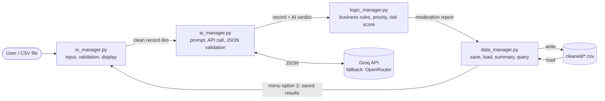

# AI Content Moderation System

**INF1103 Team Project, Phase 1 · Lab P10, Team 4**

Online platforms receive far more user comments than human moderators can read. Keyword filters miss disguised insults (`l0ser`, `i d i o t`), slang and sarcasm, and they wrongly flag people who are only *quoting* abuse in order to report it.

This command-line application takes a CSV of user comments, cleans them, and sends **every comment through an AI model** (`openai/gpt-oss-safeguard-20b` on Groq, a model built for safety classification). The model classifies each comment for harm (category, severity, target and confidence). The logic layer then turns that classification into a moderation priority (P1–P4), a recommended action, and a decision on whether a human moderator needs to review it. The results are saved to CSV and can be reopened and filtered later by category or priority.

---

## Architecture

The application is **100% procedural** (no classes) and is split into four managers that form one pipeline:



| Module | Responsibility | Key functions |
|---|---|---|
| `io_manager.py` | Handles all user interaction. It is the **only** file containing `print()` and `input()`. Lets the user pick a file, checks its columns, cleans the comment text, displays the results and a summary, and lets the user reopen saved results. | `get_input_file`, `clean_text`, `process_csv`, `print_detailed_records`, `print_summary_view`, `display_existing_cleaned_file`, `run_output_workflow`, `main_menu` |
| `ai_manager.py` | The system's core engine. Every record passes through the AI API. It builds the prompt, calls the API, parses the JSON reply and validates the schema. Contains no domain logic. | `build_prompt`, `call_api`, `call_with_fallback`, `parse_response`, `validate_response`, `analyse_record` |
| `logic_manager.py` | The domain rules. Applies the moderation business rules to the AI output and ranks reports by risk score. | `validate_data`, `get_priority`, `evaluate`, `score`, `needs_human_review`, `get_recommended_action`, `route`, `generate_report`, `process_reports` |
| `data_manager.py` | Implements data persistence. Converts reports to a table, saves them to CSV, loads saved files back, counts results for the summary, and filters them by category and/or priority. A missing, empty or unreadable saved file raises an error that `io_manager` catches, so the user can choose again. | `to_dataframe`, `save_reports`, `get_available_cleaned_files`, `validate_csv_structure`, `load_cleaned_file`, `get_summary_metrics`, `query` |
| `main.py` | Entry point. Connects the four managers in pipeline order. | `process_ai_and_logic`, `main` |

### What the AI returns

The model is forced into JSON mode, and the system prompt specifies this exact schema:

```json
{
  "harmful": true,
  "category": "harassment",
  "severity": 2,
  "target": "individual",
  "confidence": 0.95,
  "reason": "Direct personal insult with disguised spelling."
}
```

`validate_response()` rejects a reply if any of the following is true:

- a key is missing
- a value has the wrong type, or is out of range (severity must be 0–4, confidence 0–1)
- the category or target is not one of the allowed values
- the fields contradict each other (e.g. `harmful: false` with a category other than `none`)

A rejected reply is retried once. If a provider fails, the request falls back to OpenRouter's free models.

---

## Business rules

| Priority | Rule (uses AI output fields) | Recommended action |
|---|---|---|
| **P1** | severity = 4 **and** confidence ≥ 0.80 **and** (category is hate, violence or self_harm **or** target is an individual or group) | Remove user with human confirmation |
| **P2** | severity ≥ 3 **and** confidence ≥ 0.70 | Remove content with human confirmation |
| **P3** | any other harmful comment | Warn user and/or prompt human review |
| **P4** | not harmful, or severity = 0 | Monitor user |

**Human review** is required when confidence < 0.70, **or** severity ≥ 3, **or** the priority is P1/P2. If a P3 or P4 comment needs review, its action becomes *"Send to human moderator for review"*.

If the AI fails or returns an invalid result for a comment, that record is not dropped. It is marked **"Manual review required"**.

Reports are then ranked by a **risk score** from 0 to 100: `100 × (severity ÷ 4) × confidence × category weight` (hate, violence and self_harm 1.0; harassment and sexual 0.8; spam 0.5). The highest risk is listed first, and records marked for manual review are placed at the top.

---

## Project structure

```
.
├── main.py                  # entry point, connects the pipeline
├── io_manager.py            # input, validation, display
├── ai_manager.py            # AI API interaction
├── logic_manager.py         # business rules
├── data_manager.py          # CSV persistence and queries
├── tests/
│   ├── test_ai_manager.py   # prompt, parsing and validation tests (no API needed)
│   └── test_logic_manager.py# business rule tests with hardcoded AI responses
├── uncleaned/               # put input CSV files here
├── cleaned/                 # generated output (created at run time)
├── Dockerfile
├── requirements.txt
├── .env.example             # template for API keys
└── .github/workflows/ci.yml # CI/CD pipeline
```

### Input CSV format

Place CSV files in `uncleaned/`. The `username` and `comments` columns are required, with exactly these lowercase names. Files that are empty, unreadable or missing either column are rejected, and you are asked to choose another file. `User ID` must also be present as a whole number; without it, every record fails validation and is sent to manual review:

```csv
User ID,username,comments,timestamp
0,amy,yo bitch ja rule is more succesful then you ll ever be,1/1/2026 0:00
1,jame,from rfc the title is fine as it is imo,1/1/2026 0:01
```

`uncleaned/sample_uncleaned.csv` is a 10-row sample you can use straight away.

---

## Setup

### 1. Get an API key

Create a free key at [console.groq.com](https://console.groq.com/keys). An OpenRouter key from [openrouter.ai](https://openrouter.ai/keys) is optional and is only used as a fallback.

### 2. Create your `.env` file

```bash
cp .env.example .env
```

Then open `.env` and paste in your key(s):

```
AI_PROVIDER=groq
GROQ_API_KEY=gsk_your_real_key
OPENROUTER_API_KEY=sk_your_real_key
```

`.env` is listed in `.gitignore` and `.dockerignore`, so your keys are never committed or built into the image.

---

## Running with Docker

**Build the image:**

```bash
docker build -t moderation .
```

**Run the app.** The `-it` flag is required because the app is interactive. `--env-file` passes your API keys in at run time:

```bash
docker run -it --rm --env-file .env moderation
```

**Keep results between runs.** Mount the `cleaned/` folder so saved results survive after the container exits:

```bash
# macOS / Linux
docker run -it --rm --env-file .env -v "$(pwd)/cleaned:/app/cleaned" moderation

# Windows PowerShell
docker run -it --rm --env-file .env -v "${PWD}/cleaned:/app/cleaned" moderation
```

**Run the automated tests inside the container.** No API key or internet access is needed:

```bash
docker run --rm moderation python -m pytest -v
```

## Running locally (without Docker)

Requires Python 3.11+.

```bash
pip install -r requirements.txt
python main.py
python -m pytest -v
```

Use `python -m pytest`, not plain `pytest`, so the tests can import the manager modules.

---

## Using the app

```
========================================
      DATA CLEANING & MANAGEMENT MENU
========================================
1.) Cleanse New File
2.) Display Existing Cleaned File
3.) Exit
```

1. **Cleanse New File.** Pick a CSV from `uncleaned/`. The app cleans the comments: it lowercases them, expands slang (`imo` becomes `in my opinion`) and strips URLs, emails and punctuation. Digits and the symbols `$ * @ !` are kept on purpose, so disguised words like `l0ser` or `sh!t` reach the AI intact. It then sends each comment to the AI, applies the business rules and saves the results to `cleaned/<name>_cleaned.csv`.
2. **Display Existing Cleaned File.** Reopen a results file saved in `cleaned/` without calling the AI again. In Docker, mount `cleaned/` (see above) so files are still there next time.
3. In either view, the results are shown one record per card, followed by a **summary** (counts by priority and by category, and how many actions involve a human moderator). You can then **filter** by category, by priority, or both.

> The app pauses 40 seconds between comments to stay within Groq's free-tier token limit for this model, so the 10-row sample takes about 7 minutes. Use a 3–5 row file for quick demos.

### Output columns

After moderation, results are saved to `cleaned/<name>_cleaned.csv` with these columns:

| Column | Comes from | Example values |
|---|---|---|
| `User ID`, `username`, `comment` | input file (cleaned) | `0`, `amy`, `you are a pathetic l0ser` |
| `category`, `category_description` | AI, then logic manager | `harassment`, `insults, threats or mockery aimed at a specific person` |
| `priority` | logic manager rules | `P1`–`P4` |
| `recommended_action` | logic manager rules | `Remove content with human confirmation` |
| `ai_reason` | AI | one sentence explaining the classification |

---

## Error handling

| Scenario | How it is handled |
|---|---|
| API connection failure or timeout | Caught in `call_api`. The error is logged, the request falls back to OpenRouter and is retried once. If everything fails, the record is marked "Manual review required" and the app continues. |
| Malformed AI response | `parse_response` and `validate_response` reject it and the request is retried. If it still fails, the record goes to manual review. |
| Missing, empty or unreadable input file / missing columns | `get_input_file` checks the file before cleaning, rejects it and asks the user to choose again. |
| Invalid menu input | The input is rejected and the user is asked again. |
| Missing API key | The missing key is logged by name (e.g. `set GROQ_API_KEY in .env`) and the request falls back to OpenRouter. If no provider works, records are sent to manual review. |
| Free-tier rate limit | A fixed 40-second pause between comments keeps usage under the token-per-minute limit. |
| Results file open in another program (e.g. Excel) | `save_reports` logs the `PermissionError`; `main_menu` catches it, shows a message and returns to the menu. |
| Missing, empty or unreadable saved file (menu option 2) | `load_cleaned_file` raises an error; `display_existing_cleaned_file` shows it and asks the user to choose again. |
| Saved file that never finished moderation | `query` returns no matches instead of crashing, and the user sees "No matching records found." |

---

## CI/CD

GitHub Actions (`.github/workflows/ci.yml`) runs on every push and pull request:

1. **Rule checks.** Fails if any `class` definition exists, or if `print()`/`input()` appears outside `io_manager.py`.
2. **Tests.** Runs `pytest` without a live API.
3. **Docker build.** Builds the image and checks that the app files are inside it.
4. **Publish.** On merge to `main`, pushes the image to the GitHub Container Registry.

## Hard constraints checklist

| # | Constraint | How we meet it |
|---|---|---|
| C1 | 100% procedural | No `class` definitions; enforced by CI |
| C2 | AI is the core engine | Every record goes through `ai_manager.analyse_record`; without it, no comment can be classified |
| C3 | Structured API responses | JSON mode, plus schema validation before any field is used |
| C4 | Flat-file persistence | Results saved to and reloaded from CSV in `cleaned/`; `temperature: 0` reduces variation between runs |
| C5 | Runs in Docker | `Dockerfile` in the repository root; tests run inside the container |
| C6 | Git history | Feature branches and pull requests for almost every change |

---

## Use of AI

We used Claude (Anthropic) as an assistant during development. It was used to:

- review the code against the project brief and grading criteria, and point out
  missing requirements and bugs
- suggest fixes, which we reviewed, tested and merged ourselves
- draft this README, which we checked against our code and edited to better align with project specifications and our code

All design decisions, the four-manager implementation, the business rules and the
AI prompt are our team's own work. Every AI suggestion was reviewed and tested by a
team member before being merged, and our team takes full responsibility for the
submitted code.

## Team

Lab P10, Team 4. Member names and student IDs are listed in the engineering report.
