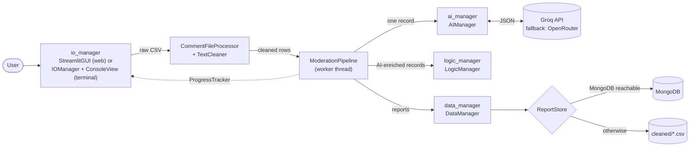
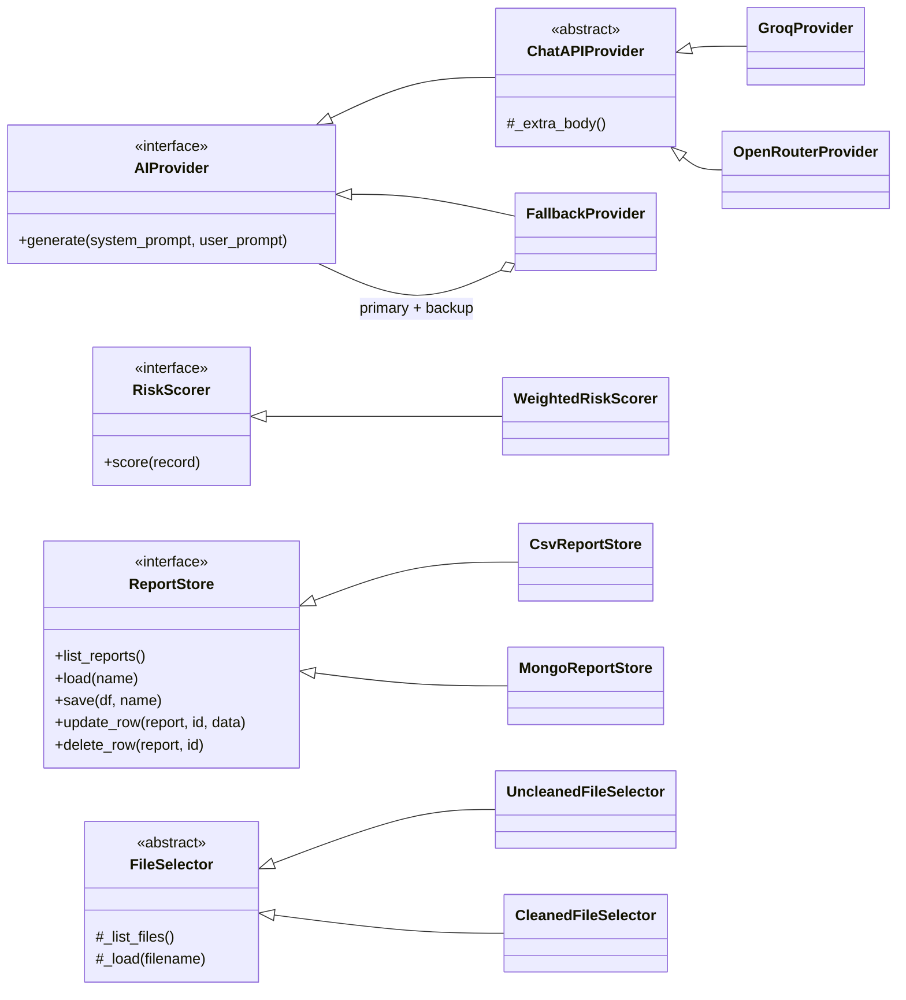
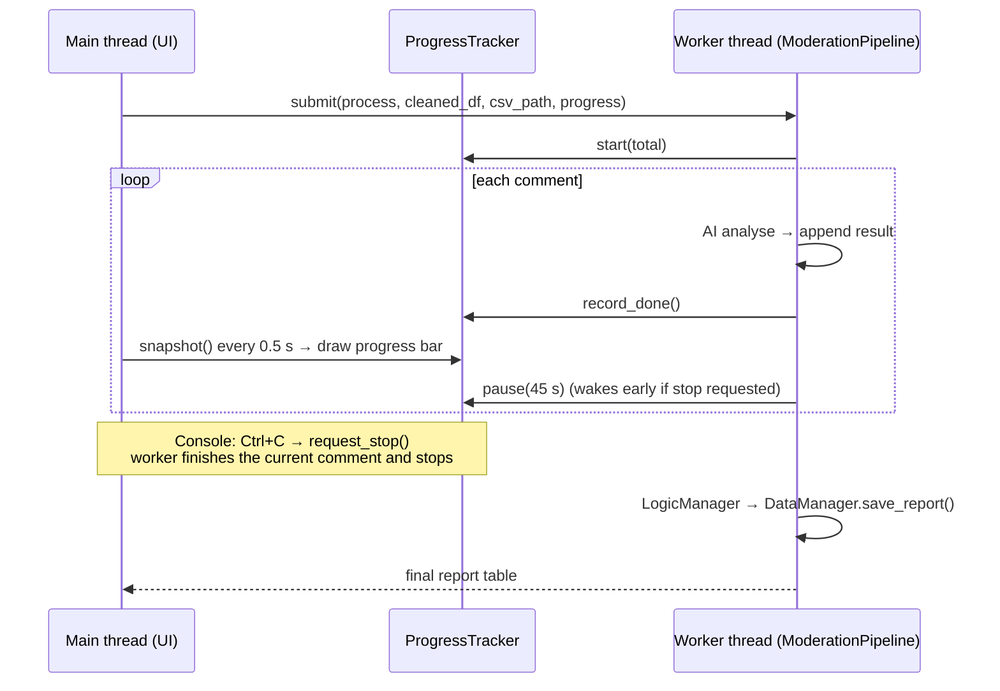

# AI Content Moderation System

**INF1103 Team Project, Phase 2 · Lab P10, Team 4**

Online platforms receive far more user comments than human moderators can read. Keyword filters miss disguised insults (`l0ser`, `i d i o t`), slang and sarcasm, and they wrongly flag people who are only *quoting* abuse in order to report it.

This application takes a CSV of user comments, cleans them, and sends **every comment through an AI model** (`openai/gpt-oss-safeguard-20b` on Groq, a model built for safety classification). The model classifies each comment for harm (category, severity, target and confidence). The logic layer then turns that classification into a moderation priority (P1–P4), a recommended action, a risk score and a decision on whether a human moderator needs to review it. The results are saved and can be reopened, filtered and edited later.

### What's new in Phase 2

| Change | What it means |
|---|---|
| **Full OOP refactor** | Every manager is now a package of classes, one class per file, built around interfaces (`AIProvider`, `RiskScorer`, `ReportStore`, `FileSelector`) so parts can be swapped without touching the rest. |
| **Streamlit web interface** | A browser dashboard to upload a CSV, watch moderation progress, load saved reports, filter them, and **edit a record's priority or delete a record**. The original text menu is still available with `--console`. |
| **Threading** | Moderation runs in a background worker thread. The interface stays responsive and shows a live progress bar; in the terminal, **Ctrl+C stops after the current comment** and keeps the results so far. |
| **MongoDB storage with CSV fallback** | Reports are stored in MongoDB when it is configured and reachable. Otherwise the app automatically falls back to CSV files in `cleaned/`. |

---

## Architecture

The application is split into four manager packages that form one pipeline. `main.py` builds the objects and chooses the interface; `ModerationPipeline` passes each record from one manager to the next inside a worker thread:



| Package | Responsibility | Key classes |
|---|---|---|
| `io_manager/` | All user interaction. `ConsoleView` and `IOManager` are the **only** files that call `print()`/`input()`. Picks and validates files, cleans comment text, shows results, summaries and filters, and runs moderation in a worker thread with a live progress bar. | `IOManager`, `ConsoleView`, `StreamlitGUI`, `FileSelector` (abstract), `UncleanedFileSelector`, `CleanedFileSelector`, `CommentFileProcessor`, `TextCleaner` |
| `ai_manager/` | The system's core engine. Every record passes through the AI API. `AIManager` builds the prompt, calls the provider, parses the JSON reply and validates the schema, with one retry. Contains no domain logic. | `AIManager`, `PromptBuilder`, `ResponseParser`, `ResponseValidator`, `AIProvider` (interface), `ChatAPIProvider` (abstract), `GroqProvider`, `OpenRouterProvider`, `FallbackProvider`, `ProviderFactory`, `ProgressTracker` |
| `logic_manager/` | The domain rules. Validates each AI result as a `ModerationRecord`, applies the moderation policy, scores risk, routes to a queue and ranks the reports. Also holds `ModerationPipeline`, which connects AI → logic → data. | `LogicManager`, `ModerationRecord`, `ModerationPolicy`, `ModerationDecision`, `RiskScorer` (interface), `WeightedRiskScorer`, `ModerationPipeline` |
| `data_manager/` | Persistence and reporting. Builds the report table, saves, loads, updates and deletes reports through a `ReportStore`, and calculates summaries and filters. | `DataManager`, `ReportStore` (interface), `CsvReportStore`, `MongoReportStore`, `ReportTableBuilder`, `ReportSummary`, `ReportQuery` |
| `main.py` | Entry point. Loads `.env`, builds the AI provider, picks MongoDB or CSV storage, creates `DataManager` and `ModerationPipeline`, then starts the Streamlit UI (default) or the console menu (`--console`). | `build_report_store`, `init_backend`, `run_console`, `run_streamlit` |

### Class design

Each interface has more than one implementation, so the rest of the code depends only on the interface:



- `ProviderFactory` reads `AI_PROVIDER` from `.env` and returns a `FallbackProvider(Groq → OpenRouter)` when both keys are present.
- `LogicManager` receives its `RiskScorer` and `ModerationPolicy` through its constructor (dependency injection), so a different scoring method can be plugged in.
- `DataManager` receives a `ReportStore`, so the same code saves to MongoDB or CSV.

### Threading

Both interfaces run `ModerationPipeline.process` in a single background thread (`ThreadPoolExecutor(max_workers=1)`). The two threads share one `ProgressTracker`, which protects its counters with a `threading.Lock` and uses a `threading.Event` as the stop signal:



### What the AI returns

The model is forced into JSON mode, and the system prompt specifies this exact schema:

```json
{
  "harmful": true,
  "category": "harassment",
  "severity": 2,
  "target": "individual",
  "confidence": 0.95,
  "reason": "Direct personal insult with disguised spelling."
}
```

`ResponseValidator.validate()` rejects a reply if any of the following is true:

- a key is missing
- a value has the wrong type, or is out of range (severity must be 0–4, confidence 0–1)
- the category or target is not one of the allowed values
- the fields contradict each other (e.g. `harmful: false` with a category other than `none`)

A rejected reply is retried once. If Groq fails, the request falls back to OpenRouter's free models. The comment is wrapped in `<comment>` tags (with any `</comment>` inside it removed), and the prompt tells the model to treat the comment as data, not instructions, to resist prompt injection.

---

## Business rules

`ModerationPolicy` applies these rules to the AI output:

| Priority | Rule (uses AI output fields) | Recommended action |
|---|---|---|
| **P1** | severity = 4 **and** confidence ≥ 0.80 **and** (category is hate, violence or self_harm **or** target is an individual or group) | Remove user with human confirmation |
| **P2** | severity ≥ 3 **and** confidence ≥ 0.70 | Remove content with human confirmation |
| **P3** | any other harmful comment | Warn user and/or prompt human review |
| **P4** | not harmful, or severity = 0 | Monitor user |

**Human review** is required when confidence < 0.70, **or** severity ≥ 3, **or** the priority is P1/P2. If a P3 or P4 comment needs review, its action becomes *"Send to human moderator for review"*. `LogicManager` routes records that need review to the `human_review` queue and the rest to the `standard` queue.

If the AI fails or returns an invalid result for a comment, that record is not dropped. `ModerationRecord` rejects it, and it is marked **"Manual review required"**.

`WeightedRiskScorer` ranks reports by a **risk score** from 0 to 100: `100 × (severity ÷ 4) × confidence × category weight` (hate, violence and self_harm 1.0; harassment and sexual 0.8; spam 0.5; not harmful 0). The highest risk is listed first, and records marked for manual review are placed at the top.

---

## Project structure

```
.
├── main.py                        # entry point: builds objects, picks storage, starts the UI
├── io_manager/
│   ├── io_manager.py              # IOManager: console menu, worker thread, filter loop
│   ├── console_view.py            # ConsoleView: tables, record cards, summary, progress bar
│   ├── gui_view_streamlit.py      # StreamlitGUI: web dashboard (upload, filter, edit, delete)
│   ├── gui_view_pyside6.py        # earlier PySide6 desktop GUI (replaced by Streamlit, not used by main.py)
│   ├── file_selector.py           # FileSelector abstract class
│   ├── uncleaned_file_selector.py # picks a raw CSV from uncleaned/ and checks its columns
│   ├── cleaned_file_selector.py   # picks a saved report through DataManager
│   ├── commentfileprocessor.py    # CommentFileProcessor: cleans a CSV, saves CSV + JSON
│   └── textcleaner.py             # TextCleaner: cleans one comment
├── ai_manager/
│   ├── ai_manager.py              # AIManager: build → generate → parse → validate
│   ├── aiprovider.py              # AIProvider interface
│   ├── chatapiprovider.py         # ChatAPIProvider abstract class (shared HTTP code)
│   ├── groqprovider.py            # GroqProvider
│   ├── openrouterprovider.py      # OpenRouterProvider (with backup models)
│   ├── fallbackprovider.py        # FallbackProvider: primary → backup
│   ├── providerfactory.py         # ProviderFactory: builds the provider from .env
│   ├── promptbuilder.py           # PromptBuilder: system prompt + <comment> tags
│   ├── responseparser.py          # ResponseParser: JSON text → dict
│   ├── responsevalidator.py       # ResponseValidator: schema checks
│   └── progresstracker.py         # ProgressTracker: shared progress + stop signal (threading)
├── logic_manager/
│   ├── logic_manager_oop.py       # LogicManager: scoring, policy, routing, ranking
│   ├── moderationrecord.py        # ModerationRecord: one validated AI result
│   ├── moderation_policy.py       # ModerationPolicy: priorities, review rule, actions
│   ├── moderation_decision.py     # ModerationDecision: priority, risk, queue, action
│   ├── riskscorer.py              # RiskScorer interface
│   ├── weightedriskscorer.py      # WeightedRiskScorer
│   └── moderationpipeline.py      # ModerationPipeline: AI → logic → data
├── data_manager/
│   ├── data_manager.py            # DataManager: one entry point for storage and reporting
│   ├── reportstore.py             # ReportStore interface
│   ├── csvreportstore.py          # CsvReportStore: reports as CSV files in cleaned/
│   ├── mongoreportstore.py        # MongoReportStore: reports as MongoDB documents
│   ├── reporttablebuilder.py      # ReportTableBuilder: fixed output columns
│   ├── reportsummary.py           # ReportSummary: counts for the summary view
│   └── reportquery.py             # ReportQuery: filter by category and/or priority
├── tests/                         # 18 test files (see Testing)
├── uncleaned/                     # put input CSV files here (console mode)
├── cleaned/                       # generated output (created at run time)
├── Documentation (Report, Docker Image & Git Repo History)/
├── Dockerfile
├── docker-compose.yml             # app + MongoDB
├── requirements.txt
└── .github/workflows/ci.yml       # CI/CD pipeline
```

### Input CSV format

The `username` and `comments` columns are required, with exactly these lowercase names. `User ID` must also be present as a whole number; without it, every record fails validation and is sent to manual review:

```csv
User ID,username,comments,timestamp
0,amy,yo bitch ja rule is more succesful then you ll ever be,1/1/2026 0:00
1,jame,from rfc the title is fine as it is imo,1/1/2026 0:01
```

In console mode, place files in `uncleaned/`. Files that are empty, unreadable or missing a required column are rejected, and you are asked to choose another file. In the web interface, upload the file instead.

`uncleaned/sample_uncleaned.csv` is a 10-row sample you can use straight away, and `uncleaned/comment_file.csv` is a 4-row file for quick demos.

---

## Setup

### 1. Get an API key

Create a free key at [console.groq.com](https://console.groq.com/keys). An OpenRouter key from [openrouter.ai](https://openrouter.ai/keys) is optional and is only used as a fallback.

### 2. Create your `.env` file

Create a file named `.env` in the project root:

```
AI_PROVIDER=groq
GROQ_API_KEY=gsk_your_real_key
OPENROUTER_API_KEY=sk_your_real_key

# Optional: MongoDB storage. Leave these out to save reports as CSV in cleaned/.
MONGO_URI=mongodb://localhost:27017
MONGO_DB_NAME=moderation
```

`.env` is listed in `.gitignore` and `.dockerignore`, so your keys are never committed or built into the image.

**Storage is chosen at startup.** If `MONGO_URI` and `MONGO_DB_NAME` are both set and MongoDB answers within 5 seconds, reports are saved to the `reports` collection of that database. Otherwise the app logs a warning and saves them as CSV files in `cleaned/`.

---

## Running locally (without Docker)

Requires Python 3.11+.

```bash
pip install -r requirements.txt

python main.py             # Streamlit web interface → opens http://localhost:8501
python main.py --console   # text menu in the terminal
python -m pytest -v        # automated tests
```

`python main.py` starts Streamlit for you; `streamlit run main.py` does the same. Use `python -m pytest`, not plain `pytest`, so the tests can import the manager packages.

---

## Running with Docker

**Build the image:**

```bash
docker build -t moderation .
```

**Web interface (default).** The image starts Streamlit on port 8501. Open http://localhost:8501 after running:

```bash
docker run --rm -p 8501:8501 --env-file .env moderation
```

**Console menu.** The `-it` flag is required because the menu is interactive:

```bash
docker run -it --rm --env-file .env moderation python main.py --console
```

**Keep results between runs.** Without MongoDB, reports are CSV files inside the container. Mount the `cleaned/` folder so they survive after the container exits:

```bash
# macOS / Linux
docker run -it --rm --env-file .env -v "$(pwd)/cleaned:/app/cleaned" moderation python main.py --console

# Windows PowerShell
docker run -it --rm --env-file .env -v "${PWD}/cleaned:/app/cleaned" moderation python main.py --console
```

**Run the automated tests inside the container.** No API key or internet access is needed:

```bash
docker run --rm moderation python -m pytest -v
```

### With MongoDB (Docker Compose)

`docker-compose.yml` starts a MongoDB 7 container (data kept in the `mongo-data` volume) next to the app and points the app at it with `MONGO_URI=mongodb://mongo:27017`. Make sure `MONGO_DB_NAME` is set in your `.env`, then:

```bash
# console menu
docker compose run --rm app python main.py --console

# web interface → http://localhost:8501
docker compose run --rm -p 8501:8501 app
```

---

## Using the app

### Web interface (Streamlit)

1. **Cleanse New File** (sidebar). Upload a CSV and press **Process File**. The comments are cleaned, then moderated in a background thread while a progress bar shows `done of total comments | mm:ss`.
2. **Load Existing Report** (sidebar). Pick a saved report from the dropdown and press **Load Report**. No AI calls are made.
3. The main area then shows:
   - a **summary**: total comments, how many are pending human review, and counts by category and priority
   - **filters** by category and/or priority
   - the **report table**
   - **Manage Records**: change a record's priority (**Edit Row**) or remove it (**Delete Row**). Changes are saved straight to the active store (MongoDB or CSV).

### Console menu

```
========================================
      DATA CLEANING & MANAGEMENT MENU
========================================
1.) Cleanse New File
2.) Display Existing Cleaned File
3.) Exit
```

1. **Cleanse New File.** Pick a CSV from `uncleaned/` (or type `back`). The app shows a preview before and after cleaning, then moderates each comment while a live progress bar runs:

   ```
   [########------------] 4 of 10 comments | 03:05 | Ctrl+C to stop
   ```

   Press **Ctrl+C** to stop early: the current comment finishes, and the results so far are processed and saved.
2. **Display Existing Cleaned File.** Reopen a saved report without calling the AI again.
3. In either view, the results are shown one record per card, followed by a **summary** (counts by priority and by category, and how many actions involve a human moderator). You can then **filter** by category, by priority, or both.

### Text cleaning

`TextCleaner` lowercases each comment, expands slang (`imo` becomes `in my opinion`) and strips URLs, emails and punctuation. Digits and the symbols `$ * @ !` are kept on purpose, so disguised words like `l0ser` or `sh!t` reach the AI intact. The cleaned file is also saved as JSON (`cleaned/<name>_cleaned.json`).

> The app pauses 45 seconds between comments to stay within Groq's free-tier limit of 2,000 tokens per minute for this model, so the 10-row sample takes about 7–8 minutes. Use `comment_file.csv` (4 rows) for quick demos.

### Output columns

Each saved report (`<name>_cleaned.csv` in `cleaned/`, or the same report name in MongoDB) has these columns, ordered by risk:

| Column | Comes from | Example values |
|---|---|---|
| `User ID`, `username`, `comment` | input file (cleaned) | `0`, `amy`, `you are a pathetic l0ser` |
| `category`, `category_description` | AI, then logic manager | `harassment`, `Insults, threats or mockery aimed at a specific person` |
| `priority` | logic manager rules | `P1`–`P4` |
| `recommended_action` | logic manager rules | `Remove content with human confirmation` |
| `ai_reason` | AI | one sentence explaining the classification |

---

## Error handling

| Scenario | How it is handled |
|---|---|
| API connection failure or timeout | Caught in `ChatAPIProvider.generate`. The error is logged, `FallbackProvider` switches to OpenRouter, and `AIManager` retries once. If everything fails, the record is marked "Manual review required" and the app continues. |
| Malformed AI response | `ResponseParser` and `ResponseValidator` reject it and `AIManager` retries. If it still fails, the record goes to manual review. |
| Invalid AI-enriched record | `ModerationRecord` raises `ValueError`; `LogicManager` keeps the record, sends it to the `human_review` queue and places it first. |
| Missing API key | The app stops at startup with a clear message (e.g. `Cannot start: Missing API key: set GROQ_API_KEY in .env`). A missing OpenRouter key only logs a warning, and the app runs without a fallback. |
| MongoDB not configured or unreachable | `build_report_store` logs a warning and uses `CsvReportStore` instead, so the app still runs. |
| Missing, empty or unreadable input file / missing columns | `UncleanedFileSelector` checks the file before cleaning, rejects it and asks the user to choose again. |
| Missing, empty or unreadable saved report | The store raises `FileNotFoundError` or `ValueError`; the console asks the user to choose again, and the web interface shows an error message. |
| User wants to stop a long run | Console: Ctrl+C sets the stop signal; the worker finishes the current comment, then saves the results so far. |
| Free-tier rate limit | Groq replies are capped at 800 tokens so each request fits the 2,000 tokens-per-minute limit, and a 45-second pause between comments lets the limit refill. If Groq still refuses, its message is logged and the request falls back to OpenRouter. |
| Results file open in another program (e.g. Excel) | `CsvReportStore.save` logs the `PermissionError`; the console menu catches it, shows a message and returns to the menu. |
| Edit/delete a User ID that is not in the report | The store raises `ValueError`, shown as "Update failed" / "Delete failed" in the web interface. |
| Saved file that never finished moderation | `ReportQuery` returns no matches instead of crashing, and the user sees "No matching records found." |
| Invalid menu input | The input is rejected and the user is asked again. |

---

## Testing

The `tests/` folder has **127 tests in 18 files**, covering every manager. No API key or internet access is needed: `tests/fakeprovider.py` stands in for the AI, and HTTP calls are mocked.

| Area | Test files |
|---|---|
| AI manager | `test_ai_manager.py`, `test_providers.py`, `test_progress.py` |
| Logic manager | `test_logic_manager_oop.py`, `test_moderationrecord.py`, `test_moderation_policy.py`, `test_moderation_decision.py`, `test_weightedriskscorer.py`, `test_moderationpipeline.py` |
| Data manager | `test_data_manager.py`, `test_reportstore.py`, `test_csvreportstore.py`, `test_mongoreportstore.py`, `test_reporttablebuilder.py` |
| IO manager | `test_io_manager.py`, `test_commentfileprocessor.py`, `test_textcleaner.py` |

The 13 MongoDB tests use a separate `moderation_test` database and are **skipped** (not failed) when MongoDB is not running, so a normal run shows `114 passed, 13 skipped`.

---

## CI/CD

GitHub Actions (`.github/workflows/ci.yml`) runs on every push and pull request:

1. **Rule checks.** Fails if `print()`/`input()` appears outside `io_manager.py` and `console_view.py`.
2. **Tests.** Runs `pytest` without a live API.
3. **Docker build and test.** Builds the image, checks that the app files are inside it, and runs the full test suite inside the container.
4. **Publish.** On merge to `main`, pushes the image to the GitHub Container Registry.

## Hard constraints checklist

| # | Constraint | How we meet it |
|---|---|---|
| C2 | AI is the core engine | Every record goes through `AIManager.analyse_record`; without it, no comment can be classified |
| C3 | Structured API responses | JSON mode, plus schema validation before any field is used |
| C4 | Persistence | Reports saved to and reloaded from CSV in `cleaned/`, or MongoDB when available; `temperature: 0` reduces variation between runs |
| C5 | Runs in Docker | `Dockerfile` and `docker-compose.yml` in the repository root; tests run inside the container |
| C6 | Git history | Feature branches and pull requests for almost every change |

---

## Use of AI

We used Claude (Anthropic) as an assistant during development. It was used to:

- review the code against the project brief and grading criteria, and point out
  missing requirements and bugs
- suggest fixes, which we reviewed, tested and merged ourselves
- draft this README, which we checked against our code and edited to better align with project specifications and our code

All design decisions, the four-manager implementation, the business rules and the
AI prompt are our team's own work. Every AI suggestion was reviewed and tested by a
team member before being merged, and our team takes full responsibility for the
submitted code.

## Team

Lab P10, Team 4. Member names and student IDs are listed in the engineering report.
